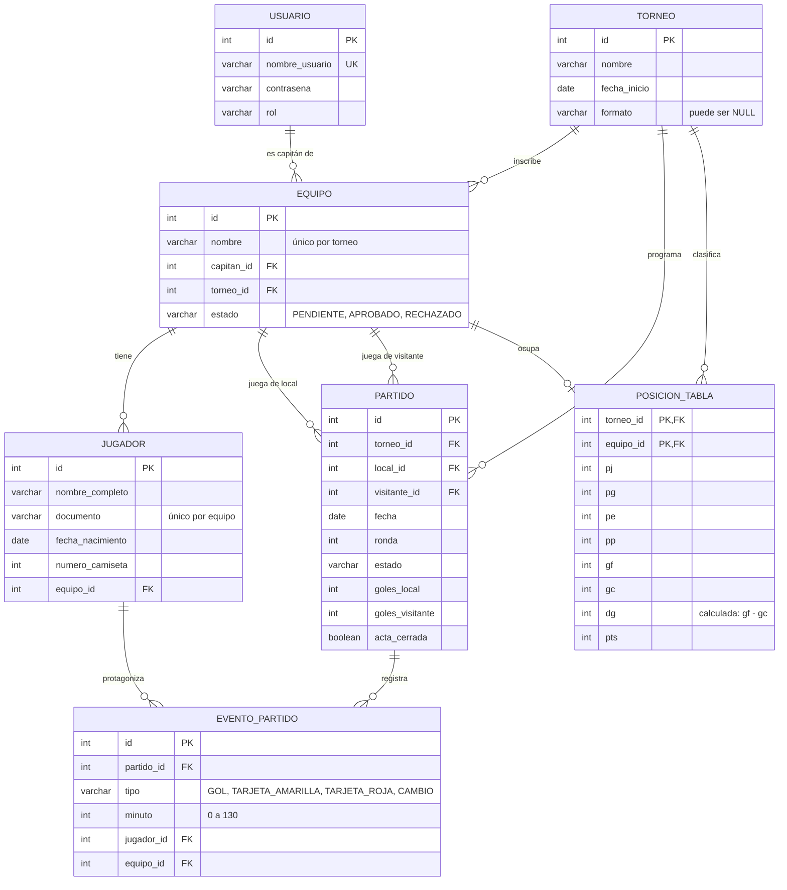

# TorneoJAV

**"Centralizando la gestión de torneos para hacer la competencia más organizada, eficiente y accesible."**

---

## Descripción

**TorneoJAV** es un sistema orientado a la gestión y administración de torneos deportivos. La plataforma busca centralizar en un solo sistema las principales actividades relacionadas con la organización de un torneo, incluyendo el registro y administración de equipos y jugadores, configuración del formato de competencia, generación automática del calendario, registro de resultados y consulta de la tabla de posiciones y estadísticas.

El sistema está diseñado para manejar diferentes tipos de usuarios y permisos según su rol. Los principales roles definidos para el sistema son **Administrador, Capitán de equipo y Árbitro/Anotador**.

TorneoJAV surge como respuesta a problemas relacionados con la gestión manual de torneos mediante herramientas como hojas de cálculo y aplicaciones de mensajería, donde la información de equipos, calendarios, resultados y posiciones puede encontrarse dispersa.

La plataforma busca facilitar la administración del torneo y permitir que la información de la competencia se encuentre organizada, actualizada y disponible para los usuarios autorizados.

---

## Equipo del Proyecto

El equipo de **TorneoJAV** se encuentra organizado mediante roles de ingeniería y responsabilidades relacionadas con las diferentes áreas funcionales y técnicas del sistema.

| **Integrante** | **Rol en el Equipo** | **Responsabilidad principal** | **GitHub** |
|---|---|---|---|
| **Juan José Ortiz** | Configuration Manager | Persistencia y datos: modelo entidad-relación, DAO/JDBC, conexión con PostgreSQL y scripts de base de datos. | [@jjortiz-lpd](https://github.com/jjortiz-lpd) |
| **Esteban Hernández** | DevOps Engineer | Autenticación y equipos: login por roles, gestión de usuarios, equipos y jugadores. | [@estebanalejandrohh-prog](https://github.com/estebanalejandrohh-prog) |
| **Natalia Valencia** | Product Owner + QA Lead | Torneos y calendario: creación de torneos, configuración de formatos y generación automática del calendario. | [@Nati393](https://github.com/Nati393) |
| **Juan Pablo Franco** | Scrum Master + Sprint Planner | Resultados y GUI: registro de resultados, tabla de posiciones, estadísticas e interfaz gráfica. | [@jpfrancor](https://github.com/jpfrancor) |

---

## Arquitectura del Proyecto

El sistema está organizado en capas:

| Capa | Paquete | Responsabilidad |
|---|---|---|
| Presentación | `App.java` (consola) y JavaFX (en desarrollo) | Pedir datos al usuario y mostrar resultados |
| Negocio | `torneojav.servicio` | Reglas de cada historia de usuario y control de acceso por rol |
| Acceso a datos | `torneojav.repositorio` y `torneojav.persistencia` | Leer y guardar en PostgreSQL mediante JDBC |
| Datos | PostgreSQL 16 | Almacenamiento persistente (`db/schema.sql`) |

Los diagramas de componentes, clases, despliegue y análisis (ECB) están en `docs/diagramas/`.

---

## Estructura del Proyecto

```text
PROYECTO_CALI/
├── src/
│   ├── App.java                      Punto de entrada: login y menús por rol (consola)
│   └── torneojav/
│       ├── modelo/                   Entidades: Torneo, Equipo, Jugador, Partido, EventoPartido,
│       │                             PosicionTabla, EstadisticasTorneo, Usuario y enums
│       ├── servicio/                 Reglas de negocio de cada HU
│       │   ├── calendario/           IGeneradorCalendario y sus dos implementaciones (HU-07)
│       │   └── posiciones/           ICriterioDesempate y CriterioEstandarTorneo (HU-09)
│       ├── repositorio/              Interfaces de acceso a datos y sus implementaciones
│       │                             ...Postgres (JDBC) y ...Memoria (pruebas sin base)
│       ├── persistencia/             GestorConexionJDBC: lee db.properties y abre conexiones
│       └── excepcion/                Excepciones del dominio
├── db/
│   └── schema.sql                    Crea las tablas y carga los datos de prueba
├── lib/
│   └── postgresql-42.7.14.jar        Driver JDBC de PostgreSQL
├── docs/                             Documentación de ingeniería y diagramas
├── graficas/                         Lean Canvas
├── .vscode/                          Configuración para compilar y ejecutar en VS Code
├── db.properties.example             Plantilla de la configuración de conexión
└── .gitignore
```

Cada servicio depende de las interfaces del paquete `repositorio` y no de una implementación concreta. `App.java` decide cuál usar: hoy usa las clases `...Postgres`; si se cambian por las `...Memoria`, el programa funciona igual sin base de datos.

---

## Base de Datos

TorneoJAV usa PostgreSQL 16. El esquema completo está en `db/schema.sql` y tiene 7 tablas:

| Tabla | Contenido | HU |
|---|---|---|
| `usuario` | Usuarios del sistema con su rol (ADMINISTRADOR, CAPITAN, ARBITRO) | HU-01 |
| `torneo` | Nombre, fecha de inicio y formato del torneo | HU-02, HU-03 |
| `equipo` | Equipos, su capitán, el torneo y el estado de inscripción | HU-04, HU-06 |
| `jugador` | Plantilla de cada equipo | HU-05 |
| `partido` | Calendario: equipos, fecha, ronda, estado, marcador y si el acta está cerrada | HU-07, HU-08 |
| `evento_partido` | Goles, tarjetas y cambios de cada partido | HU-08 |
| `posicion_tabla` | Tabla de posiciones por torneo; se reescribe al cerrar cada acta | HU-09 |

Las estadísticas de HU-10 no tienen tabla propia: se calculan a partir de `partido`, `evento_partido` y `posicion_tabla`.

### Diagrama entidad-relación



### Reglas que garantiza la base de datos

Además de las validaciones en Java, el esquema rechaza datos inválidos aunque alguien los intente insertar directamente:

| Regla | Cómo se garantiza |
|---|---|
| No hay dos equipos con el mismo nombre en un torneo, sin importar mayúsculas | Índice único sobre `(torneo_id, LOWER(nombre))` |
| Un jugador no se repite dentro de la misma plantilla | `UNIQUE (equipo_id, documento)` |
| Un equipo no juega contra sí mismo | `CHECK (local_id <> visitante_id)` |
| Roles, formatos, estados y tipos de evento solo aceptan valores válidos | `CHECK (... IN (...))` en cada columna |
| La diferencia de goles siempre coincide con GF y GC | `dg` es una columna generada: `GENERATED ALWAYS AS (gf - gc) STORED` |
| Los partidos jugados cuadran con ganados, empatados y perdidos | `CHECK (pj = pg + pe + pp)` |
| La tabla de posiciones nunca queda a medias | Se reescribe dentro de una transacción (`commit` / `rollback`) en `PosicionRepositorioPostgres` |

---

## Conexión

El acceso a la base de datos se hace con JDBC, usando una clase repositorio por entidad (`TorneoRepositorioPostgres`, `EquipoRepositorioPostgres`, etc.). Todas las consultas usan `PreparedStatement`, así que los datos que escribe el usuario nunca se pegan dentro del SQL y no hay riesgo de inyección SQL.

`GestorConexionJDBC` lee los datos de conexión del archivo `db.properties`, que va en la raíz del proyecto:

```properties
db.url=jdbc:postgresql://localhost:5432/torneojav
db.usuario=postgres
db.contrasena=SU_CLAVE
```

Este archivo está en el `.gitignore` y no se sube a GitHub, porque cada integrante tiene su propia contraseña. En el repositorio solo está la plantilla `db.properties.example`.

Si las credenciales no son correctas o PostgreSQL está apagado, el programa lo avisa al arrancar y se cierra, en vez de fallar más adelante.

---

## Instalación y Ejecución

### Requisitos

- Java 17 o superior
- PostgreSQL 16 o superior (incluye pgAdmin)
- Git
- Visual Studio Code con el Extension Pack for Java

El driver de PostgreSQL ya viene en `lib/`, así que no hay que descargar nada más. El proyecto no usa Maven ni Gradle.

Clonar el repositorio:

```bash
git clone https://github.com/jjortiz-lpd/PROYECTO_CALI.git
cd PROYECTO_CALI
```

---

## Configuración de la Base de Datos

1. Instalar PostgreSQL y anotar la contraseña del usuario `postgres` que se pide durante la instalación.
2. Crear la base de datos. En pgAdmin: clic derecho en "Databases" > "Create" > "Database...", con el nombre `torneojav`. Por terminal:
   ```bash
   psql -U postgres -c "CREATE DATABASE torneojav;"
   ```
3. Crear las tablas y cargar los datos de prueba. En pgAdmin: clic derecho en `torneojav` > "Query Tool", abrir `db/schema.sql` y ejecutar con F5. Por terminal:
   ```bash
   psql -U postgres -d torneojav -f db/schema.sql
   ```
4. Copiar `db.properties.example` como `db.properties` (en la misma carpeta) y poner la contraseña propia en `db.contrasena`.

`schema.sql` borra las tablas y las vuelve a crear, así que también sirve para reiniciar los datos cuando se quiera empezar de cero. Si cambia el esquema (por ejemplo, al agregar una tabla nueva), hay que volver a ejecutarlo.

### Datos de prueba

| Usuario | Contraseña | Rol |
|---|---|---|
| `admin` | `admin123` | Administrador |
| `capitan` | `cap123` | Capitán de Tigres, Pumas y Halcones |
| `capitan2` | `cap456` | Capitán de Leones y Cóndores |
| `arbitro` | `arb123` | Árbitro |

El torneo de prueba es la "Copa Javeriana" (todos contra todos). Tiene 4 equipos aprobados (Tigres, Leones, Cóndores y Halcones) y Pumas pendiente de aprobación. Los partidos no vienen cargados: se crean desde el menú del administrador con "Generar calendario".

| Equipo | Ids de sus jugadores |
|---|---|
| Tigres | 1 a 8 |
| Leones | 9 a 15 |
| Cóndores | 16 a 20 |
| Halcones | 21 a 25 |

---

## Ejecución de la Aplicación

En VS Code: abrir la carpeta `PROYECTO_CALI` (la raíz, no `src`) y presionar F5, o en "Run and Debug" elegir la configuración "TorneoJAV".

Por terminal, desde la raíz del proyecto:

```bash
# Windows
javac -d bin -cp "lib/*" -sourcepath src src/App.java
java -cp "bin;lib/*" App

# Linux / macOS
javac -d bin -cp "lib/*" -sourcepath src src/App.java
java -cp "bin:lib/*" App
```

La versión actual funciona por consola. Al iniciar pide usuario y contraseña y muestra el menú del rol correspondiente:

| Rol | Puede hacer |
|---|---|
| Administrador | Crear, modificar, eliminar y configurar torneos; aprobar o rechazar inscripciones; generar el calendario y las rondas de eliminación directa |
| Capitán | Registrar y modificar sus equipos; administrar la plantilla (entre 5 y 15 jugadores de 16 a 45 años); ver el estado de inscripción |
| Árbitro | Registrar goles, tarjetas y cambios; cerrar el acta del partido |
| Todos | Consultar partidos programados, resultados, tabla de posiciones y estadísticas |

La interfaz gráfica en JavaFX está en desarrollo y usará los mismos servicios.

---

## Ejecución de Pruebas

El proyecto todavía no tiene pruebas automáticas. Mientras tanto, este recorrido verifica las funcionalidades principales con los datos de prueba:

| # | Usuario | Acción | Resultado esperado |
|---|---|---|---|
| 1 | `admin` / clave errada | Iniciar sesión | Mensaje de credenciales incorrectas (HU-01) |
| 2 | `admin` | Opción 5: generar calendario | 6 partidos en 3 jornadas, sin Pumas (HU-07) |
| 3 | `admin` | Opción 5 otra vez | Error: el calendario ya fue generado (HU-07 CA-05) |
| 4 | `admin` | Opción 11: cambiar formato del torneo 1 | Error: ya hay calendario (HU-03) |
| 5 | `capitan` | Agregar un jugador de 14 años | Error de edad (HU-05) |
| 6 | `capitan` | Ver jugadores del equipo 2 (Leones) | Error: no es su equipo (HU-05 CA-06) |
| 7 | `arbitro` | Registrar 2 goles del jugador 1 en el partido 1 y cerrar el acta | Partido 1 queda 2-0 y la tabla se actualiza (HU-08, HU-09) |
| 8 | `arbitro` | Registrar un evento en el partido 1 | Error: el acta está cerrada (HU-08 CA-06) |
| 9 | cualquiera | Consultas > Tabla de posiciones | Tigres primero con 3 puntos (HU-09) |
| 10 | cualquiera | Consultas > Estadísticas | 1 partido jugado, 2 goles, Tigres más goleador (HU-10) |

Para repetir el recorrido desde cero, volver a ejecutar `db/schema.sql`.

---

## Documentación del Proyecto

La documentación de TorneoJAV se encuentra organizada en diferentes documentos dentro del directorio `docs/` que cubren las distintas etapas de planificación y análisis del proyecto:

* **Lean Canvas (`canvas.md`):** Define el problema, usuarios, propuesta de valor y solución del proyecto.
* **WBS (`WBS.md`):** Divide el proyecto en componentes y actividades de trabajo.
* **Organigrama (`organigrama.md`):** Define los roles y responsabilidades dentro del equipo.
* **Calendario (`calendario.md`):** Organiza las actividades a lo largo de las semanas del proyecto.
* **Planeación Ágil (`planeacion-agil.md`):** Establece el marco iterativo, flujo funcional y criterio de terminado.
* **Plan de Sprints (`plan-sprints.md`):** Define la distribución de las historias de usuario por Sprint.
* **Historias de Usuario (`historias-usuario.md`):** Define las necesidades, funcionalidades y criterios de aceptación por rol.
* **Casos de Uso (`casos-de-uso.md`):** Describe las interacciones entre actores y el sistema.
* **Requisitos Funcionales (`requisitos-funcionales.md`):** Especifica las funciones que debe realizar el sistema (`RF-01` a `RF-33`).
* **Requisitos No Funcionales (`requisitos-no-funcionales.md`):** Define características de calidad y restricciones del sistema (`RNF-01` a `RNF-06`).
* **Estimación (`estimacion.md`):** Presenta la estimación del esfuerzo de desarrollo en Story Points.
* **Herramientas (`herramientas.md`):** Documenta el stack tecnológico y las herramientas de gestión utilizadas.
* **Reporte Gerencial (`reporte-gerencial.md`):** Presenta el estado y avance general del proyecto.
* **Actas (`actas.md`):** Registra las reuniones, acuerdos y seguimiento de tareas del equipo.

---

## Contexto Académico

- **Proyecto:** TorneoJAV
- **Asignatura:** Fundamentos de Ingeniería de Software
- **Institución:** Pontificia Universidad Javeriana
- **Periodo:** 3
- **Docente:** Kerwin de Jesús Barros Somerson

---

## Repositorio

El código fuente y la gestión del proyecto se encuentran en GitHub:

- **Repositorio:** https://github.com/jjortiz-lpd/PROYECTO_CALI

---

## Contacto

**Equipo de desarrollo de TorneoJAV:**

- **Juan José Ortiz** — Configuration Manager  
  Estudiante de Ingeniería de Sistemas, Pontificia Universidad Javeriana  
  GitHub: [@jjortiz-lpd](https://github.com/jjortiz-lpd)

- **Esteban Hernández** — DevOps Engineer  
  Estudiante de Ingeniería de Sistemas, Pontificia Universidad Javeriana  
  GitHub: [@estebanalejandrohh-prog](https://github.com/estebanalejandrohh-prog)

- **Natalia Valencia** — Product Owner + QA Lead  
  Estudiante de Ingeniería de Sistemas, Pontificia Universidad Javeriana  
  GitHub: [@Nati393](https://github.com/Nati393)

- **Juan Pablo Franco** — Scrum Master + Sprint Planner  
  Estudiante de Ingeniería de Sistemas, Pontificia Universidad Javeriana  
  GitHub: [@jpfrancor](https://github.com/jpfrancor)

---

## Licencia

Proyecto desarrollado con fines académicos.
