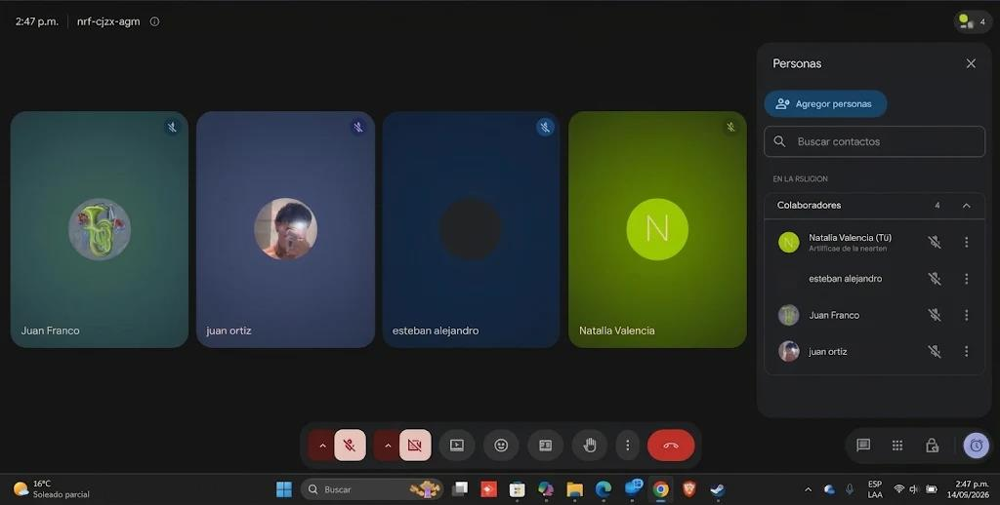
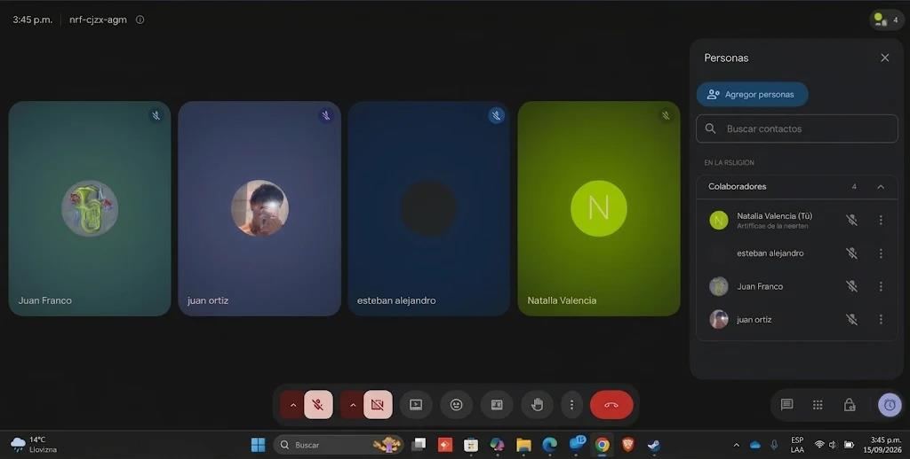
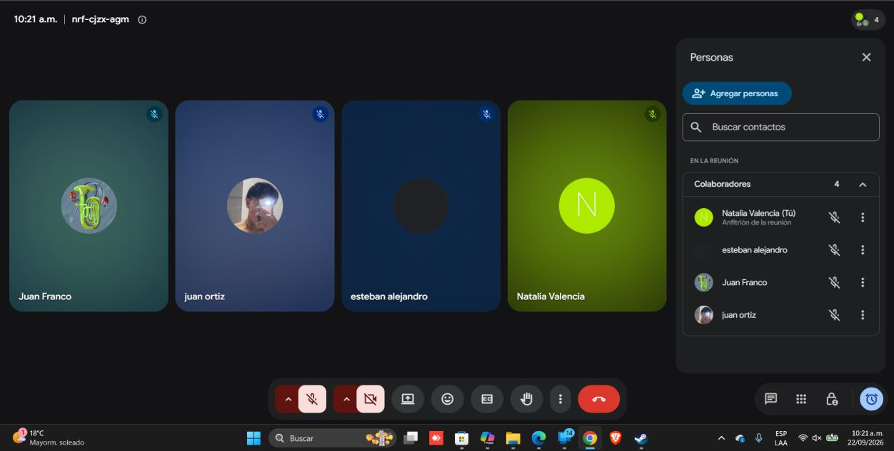
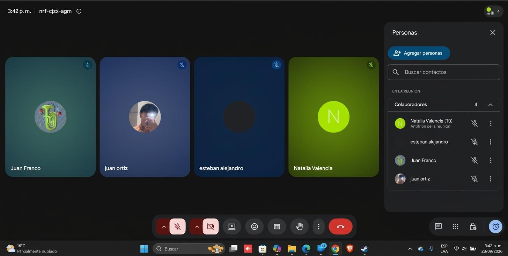
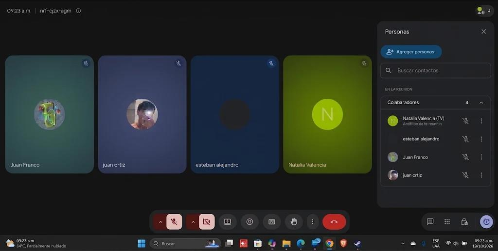
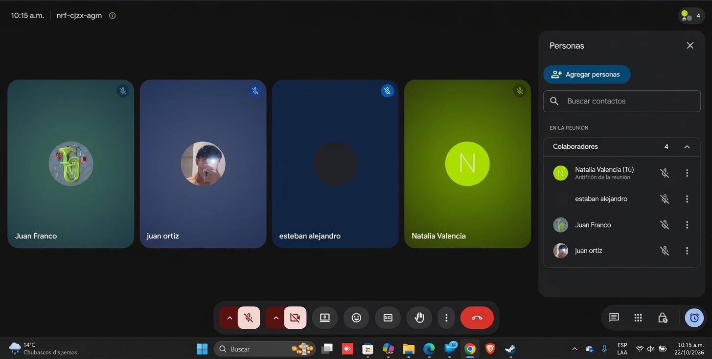
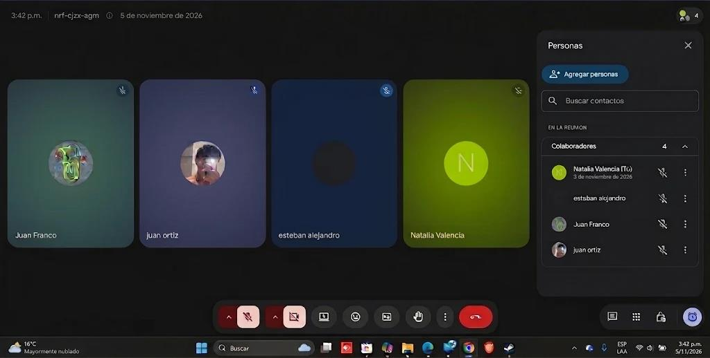

# Informe de Daily Meetings

Registro de las reuniones diarias (Daily Scrum) del equipo de TorneoJAV, realizadas por Google Meet (código de sala `nrf-cjzx-agm`). Las capturas de cada reunión están en la carpeta [evidencias](evidencias/).

## Participantes
En todas las reuniones aparecen conectados los cuatro integrantes del equipo:
- Natalia Valencia 
- Esteban Alejandro
- Juan Franco
- Juan Ortiz

## Convención de nombres
```text
daily-AAAA-MM-DD.png
```
- `AAAA-MM-DD` es la fecha de la reunión (año, mes, día), lo que permite que los archivos se ordenen cronológicamente.
- Ejemplo: `daily-2026-10-13.png` corresponde al daily del 13 de octubre de 2026.

## Resumen
- Total de dailies documentados: 34
- Periodo: 14/09/2026 al 13/11/2026

| Periodo | Dailies |
|---|---|
| Previo al Sprint 1 (14/09 – 25/09) | 9 |
| Sprint 1 (28/09 – 12/10) | 8 |
| Sprint 2 (12/10 – 26/10) | 5 |
| Sprint 3 (26/10 – 09/11) | 7 |
| Sprint 4 (09/11 – 23/11) | 5 |
| **Total** | **34** |

## Dailies previos al Sprint 1 (14/09 – 25/09)

| Fecha | Hora | Evidencia |
|---|---|---|
| 14/09/2026 | 2:47 p. m. |  |
| 15/09/2026 | 3:45 p. m. |  |
| 16/09/2026 | 4:12 p. m. |  |
| 17/09/2026 | 4:52 p. m. |  |
| 18/09/2026 | 2:56 p. m. |  |
| 22/09/2026 | 10:21 a. m. |  |
| 23/09/2026 | 3:42 p. m. |  |
| 24/09/2026 | 4:42 p. m. |  |
| 25/09/2026 | 3:34 p. m. |  |

## Sprint 1 (28/09 – 12/10)

| Fecha | Hora | Evidencia |
|---|---|---|
| 28/09/2026 | 2:15 p. m. |  |
| 30/09/2026 | 3:34 p. m. |  |
| 01/10/2026 | 2:30 p. m. |  |
| 02/10/2026 | 2:30 p. m. |  |
| 05/10/2026 | 4:15 p. m. |  |
| 06/10/2026 | 4:15 p. m. |  |
| 07/10/2026 | 11:32 a. m. |  |
| 08/10/2026 | 11:32 a. m. |  |

## Sprint 2 (12/10 – 26/10)

| Fecha | Hora | Evidencia |
|---|---|---|
| 13/10/2026 | 3:15 p. m. |  |
| 15/10/2026 | 4:15 p. m. |  |
| 19/10/2026 | 9:23 a. m. |  |
| 20/10/2026 | 2:43 p. m. |  |
| 22/10/2026 | 10:15 a. m. |  |

## Sprint 3 (26/10 – 09/11)

| Fecha | Hora | Evidencia |
|---|---|---|
| 27/10/2026 | 3:14 p. m. |  |
| 28/10/2026 | 5:32 p. m. |  |
| 29/10/2026 | 9:15 a. m. |  |
| 30/10/2026 | 4:25 p. m. |  |
| 03/11/2026 | 11:15 a. m. |  |
| 05/11/2026 | 3:42 p. m. |  |
| 06/11/2026 | 2:15 p. m. |  |

## Sprint 4 (09/11 – 23/11)

| Fecha | Hora | Evidencia |
|---|---|---|
| 09/11/2026 | 2:37 p. m. |  |
| 10/11/2026 | 3:15 p. m. |  |
| 11/11/2026 | 4:30 p. m. |  |
| 12/11/2026 | 2:45 p. m. |  |
| 13/11/2026 | 10:15 a. m. |  |
