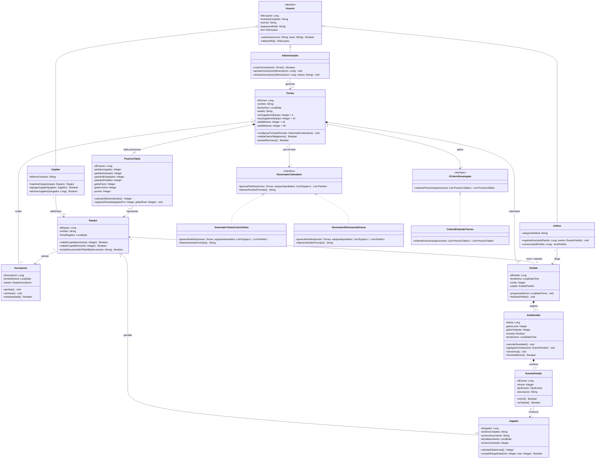

# Diagrama de Clases y Principios SOLID — TorneoJAV

## 1. Descripción del Modelo de Clases
El diagrama de clases modela la estructura estática del dominio de **TorneoJAV**, sus interfaces de servicio/estrategia y las relaciones estructurales entre entidades:
- **Herencia / Realización (`<|--` / `<|..`):** Especialización de roles de usuario (`Administrador`, `Capitan`, `Arbitro` heredan de `Usuario`) e implementación de algoritmos de calendario (`GeneradorTodosContraTodos`, `GeneradorEliminacionDirecta` implementan `IGeneradorCalendario`).
- **Composición (`*--`):** Ciclo de vida fuertemente acoplado (`Partido` contiene `ActaPartido`; `ActaPartido` contiene `EventoPartido`; `Torneo` contiene `PosicionTabla`).
- **Agregación (`o--`):** Agrupación donde la parte puede existir independientemente del contenedor (`Equipo` agrupa objetos `Jugador`; `Torneo` agrupa `Inscripcion`).
- **Asociación (`-->`):** Vínculos estructurales con multiplicidad explícita (`Capitan 1 --> 0..1 Equipo`, `Arbitro 1 --> 0..* Partido`).

---

## 2. Representación Gráfica (UML / Mermaid)

---

## 3. Aplicación de los Principios SOLID en el Diseño

1. **SRP — Single Responsibility Principle (Principio de Responsabilidad Única):**
   Cada clase tiene una única razón para cambiar. `Partido` gestiona la programación del encuentro (equipos, fecha, ronda y estado), mientras que `ActaPartido` encapsula el marcador, los eventos y el bloqueo de cierre arbitral, y `PosicionTabla` se encarga exclusivamente del cómputo estadístico (`PJ`, `PG`, `PE`, `PP`, `PTS`, `GF`, `GC`, `DG`).
2. **OCP — Open/Closed Principle (Principio de Abierto/Cerrado):**
   La generación del calendario está abierta a la extensión pero cerrada a la modificación mediante la interfaz `IGeneradorCalendario`. Si en el futuro se agrega un formato *"Fase de grupos + Eliminatoria"*, basta con crear una nueva clase que implemente `IGeneradorCalendario` sin alterar el código de `Torneo` ni de `GenerarCalendarioCtrl`. Lo mismo ocurre con `ICriterioDesempate`.
3. **LSP — Liskov Substitution Principle (Principio de Sustitución de Liskov):**
   Las subclases `Administrador`, `Capitan` y `Arbitro` respetan el contrato de la superclase `Usuario` (`autenticar()` y `obtenerRol()`), y tanto `GeneradorTodosContraTodos` como `GeneradorEliminacionDirecta` pueden sustituirse de forma transparente donde se espera un `IGeneradorCalendario`, retornando siempre una lista válida de objetos `Partido` sin efectos secundarios inesperados.
4. **ISP — Interface Segregation Principle (Principio de Segregación de Interfaces):**
   En lugar de definir una interfaz monolítica `ITorneoManager` que obligue a implementar métodos de calendario, arbitraje y posiciones en una sola clase, los contratos están segregados en interfaces específicas de dominio (`IGeneradorCalendario`, `ICriterioDesempate` y DAOs separados por entidad), de modo que cada servicio depende únicamente de los métodos que utiliza.
5. **DIP — Dependency Inversion Principle (Principio de Inversión de Dependencias):**
   Los módulos de alto nivel (`Torneo`, controladores de negocio) no dependen de implementaciones concretas de bajo nivel (como algoritmos fijos de emparejamiento o consultas SQL directas), sino de abstracciones (`IGeneradorCalendario`, `ICriterioDesempate` e interfaces `IRepositorioDAO<T>`).
