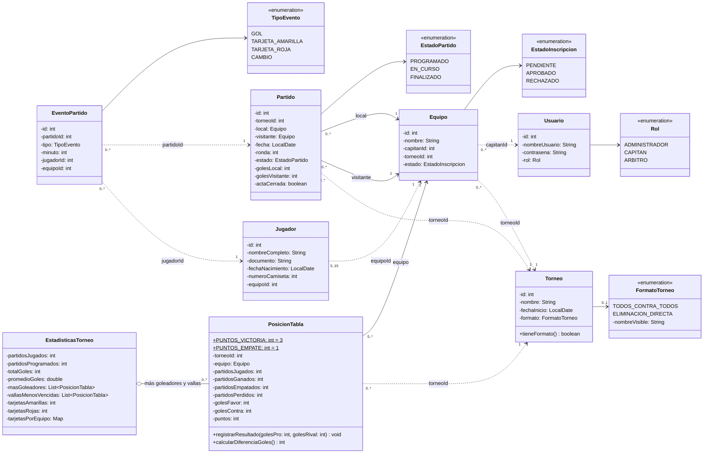
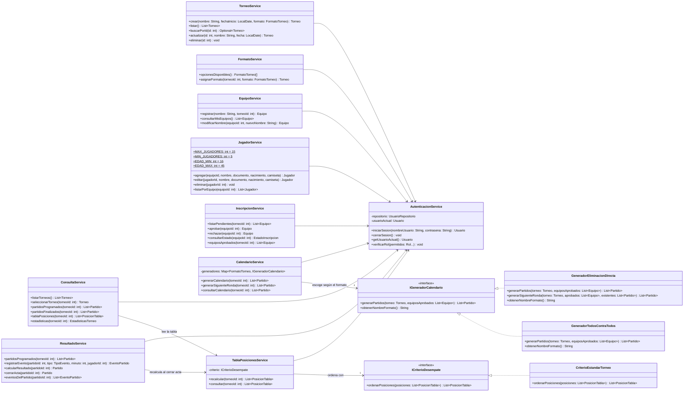
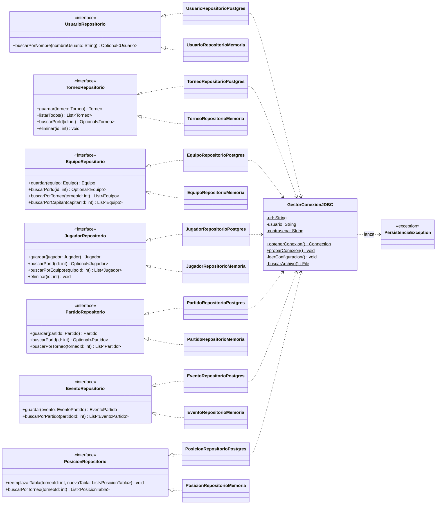

# Diagrama de Clases — TorneoJAV

## 1. Descripción

Este diagrama muestra las clases tal como están implementadas en `src/torneojav/`. Para que se pueda leer, está dividido en tres partes que corresponden a las capas del sistema:

| Parte | Paquete | Contenido |
|---|---|---|
| 2.1 Dominio | `torneojav.modelo` | Entidades y enumeraciones |
| 2.2 Negocio | `torneojav.servicio` | Servicios por historia de usuario y estrategias de calendario y desempate |
| 2.3 Persistencia | `torneojav.repositorio`, `torneojav.persistencia` | Interfaces de repositorio, implementaciones JDBC y en memoria, conexión |

Notación usada:

| Símbolo | Significado |
|---|---|
| `<\|--` | Herencia |
| `<\|..` | Realización (una clase implementa una interfaz) |
| `o--` | Agregación |
| `-->` | Asociación: la clase tiene un atributo de ese tipo |
| `..>` | Dependencia: la clase usa a la otra o la referencia por su id |

Los getters, setters y `toString()` se omiten.

---

## 2. Representación Gráfica (UML / Mermaid)

### 2.1 Dominio (`torneojav.modelo`)

### 2.2 Negocio (`torneojav.servicio`)

Todos los servicios reciben un `AutenticacionService` y llaman a `verificarRol(...)` al comienzo de las operaciones que exigen un rol. Así se cumple HU-01 CA-07 en la capa de negocio y no solo en el menú.

Repositorios que usa cada servicio (todos se reciben por el constructor como interfaz):

| Servicio | HU | Repositorios |
|---|---|---|
| `AutenticacionService` | HU-01 | `UsuarioRepositorio` |
| `TorneoService` | HU-02 | `TorneoRepositorio`, `EquipoRepositorio`, `PartidoRepositorio` |
| `FormatoService` | HU-03 | `TorneoRepositorio`, `PartidoRepositorio` |
| `EquipoService` | HU-04 | `EquipoRepositorio` |
| `JugadorService` | HU-05 | `JugadorRepositorio`, `EquipoRepositorio` |
| `InscripcionService` | HU-06 | `EquipoRepositorio` |
| `CalendarioService` | HU-07 | `TorneoRepositorio`, `EquipoRepositorio`, `PartidoRepositorio` |
| `ResultadoService` | HU-08 | `PartidoRepositorio`, `EventoRepositorio`, `JugadorRepositorio`, `TorneoRepositorio` |
| `TablaPosicionesService` | HU-09 | `PosicionRepositorio`, `PartidoRepositorio`, `EquipoRepositorio` |
| `ConsultaService` | HU-10 | `TorneoRepositorio`, `PartidoRepositorio`, `EventoRepositorio` |

### 2.3 Persistencia (`torneojav.repositorio` y `torneojav.persistencia`)

Cada interfaz tiene dos implementaciones:

| Implementación | Dónde guarda | Para qué |
|---|---|---|
| `...RepositorioPostgres` | PostgreSQL, con JDBC y `PreparedStatement` | La que usa la aplicación |
| `...RepositorioMemoria` | Una `List` en memoria | Probar la lógica de negocio sin base de datos |

`GestorConexionJDBC` lee la URL, el usuario y la contraseña de `db.properties` una sola vez y abre una conexión nueva en cada operación. Cada repositorio la cierra con `try-with-resources`. `PosicionRepositorioPostgres.reemplazarTabla` es la única operación que usa una transacción explícita (`setAutoCommit(false)`, `commit()`, `rollback()`), porque borra y vuelve a escribir varias filas que deben cambiar juntas.

### 2.4 Excepciones (`torneojav.excepcion`)

Todas heredan de `RuntimeException`, así que no obligan a usar `throws` en cada método. La interfaz las atrapa y muestra el mensaje al usuario.

| Excepción | Se lanza cuando |
|---|---|
| `CredencialesInvalidasException` | El usuario o la contraseña no coinciden (HU-01) |
| `AccesoDenegadoException` | El rol no tiene permiso, o un capitán intenta tocar un equipo ajeno |
| `DatosInvalidosException` | Falta un dato obligatorio o se rompe una regla de negocio |
| `EquipoDuplicadoException` | Ya existe un equipo con ese nombre en el torneo (HU-04) |
| `FormatoNoDefinidoException` | Se intenta generar el calendario de un torneo sin formato (HU-03, HU-07) |
| `ActaCerradaException` | Se intenta modificar un partido cuya acta ya se cerró (HU-08) |
| `PersistenciaException` | Falla la conexión o una consulta a PostgreSQL. Envuelve la `SQLException` |

---

## 3. Aplicación de los Principios SOLID

1. **SRP (Responsabilidad Única).** Cada servicio atiende una sola historia de usuario: `CalendarioService` solo arma calendarios y `TablaPosicionesService` solo calcula posiciones. Dentro de la persistencia, cada repositorio maneja una tabla y `GestorConexionJDBC` es el único que sabe cómo conectarse. Si cambia la contraseña de la base, se toca un archivo de configuración y ninguna clase.

2. **OCP (Abierto/Cerrado).** `CalendarioService` guarda los generadores en un `Map<FormatoTorneo, IGeneradorCalendario>`. Para agregar un formato nuevo (por ejemplo, fase de grupos) se crea otra clase que implemente `IGeneradorCalendario`, se agrega el valor al enum y se registra en el mapa. El algoritmo de los formatos que ya existen no se modifica. `ICriterioDesempate` funciona igual para la tabla de posiciones.

3. **LSP (Sustitución de Liskov).** `GeneradorTodosContraTodos` y `GeneradorEliminacionDirecta` se usan a través de la interfaz sin que el servicio sepa cuál es. Lo mismo pasa con los repositorios: `TorneoRepositorioPostgres` y `TorneoRepositorioMemoria` son intercambiables y los servicios se comportan igual con cualquiera de los dos.

4. **ISP (Segregación de Interfaces).** No hay un repositorio genérico con todos los métodos posibles. Cada interfaz tiene solo lo que sus servicios necesitan: `UsuarioRepositorio` tiene un solo método, `EventoRepositorio` no tiene `eliminar` porque los eventos de un acta no se borran y `PosicionRepositorio` reemplaza la tabla completa en lugar de editar filas sueltas.

5. **DIP (Inversión de Dependencias).** Los servicios dependen de interfaces (`EquipoRepositorio`, `ICriterioDesempate`) y las reciben por el constructor. La única clase que crea objetos concretos es `App.java`, en su método `main`. Para cambiar PostgreSQL por memoria basta con cambiar las líneas `new ...RepositorioPostgres()` por `new ...RepositorioMemoria()` en ese método.

---

## 4. Cambios respecto al diseño inicial

El primer diagrama se hizo antes de programar. Durante la implementación se simplificaron algunas partes; esta tabla registra qué cambió y por qué:

| Diseño inicial | Implementación | Motivo |
|---|---|---|
| `Administrador`, `Capitan` y `Arbitro` heredan de `Usuario` | Una sola clase `Usuario` con el enum `Rol` | Los tres roles tienen los mismos datos; lo que cambia son los permisos, y eso se controla con `verificarRol` |
| Clase `Inscripcion` aparte | Atributo `estado` en `Equipo` | Un equipo se inscribe en un solo torneo, así que la inscripción no necesita tabla propia |
| Clase `ActaPartido` aparte | Atributos `golesLocal`, `golesVisitante` y `actaCerrada` en `Partido` | Cada partido tiene una sola acta. El marcador se calcula a partir de `EventoPartido` |
| `IGenericDAO<T, ID>` para todas las entidades | Una interfaz de repositorio por entidad | No todas las entidades necesitan los mismos métodos (ver ISP) |
| Conexión con patrón Singleton | `GestorConexionJDBC` con métodos estáticos que abren una conexión por operación | Una conexión compartida se puede quedar abierta o caerse; abrir y cerrar en cada operación es más simple y seguro para una aplicación de un solo usuario |
| Observador `IObservadorCierreActa` | `ResultadoService` llama directamente a `TablaPosicionesService.recalcular` | Solo hay una acción que depende del cierre del acta. Si se agregan más (por ejemplo, notificar a los capitanes), conviene volver al observador |
