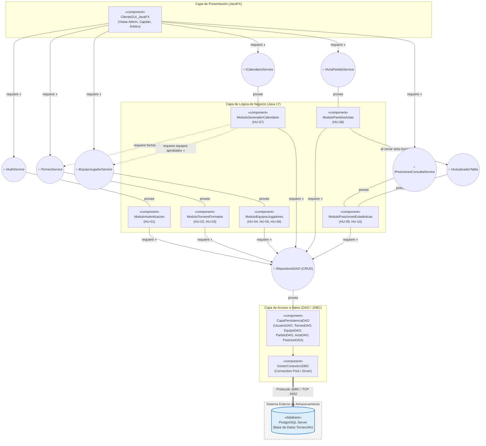

# Diagrama de Componentes — TorneoJAV

## 1. Descripción de la Arquitectura Modular
El diagrama de componentes representa la arquitectura modular de **TorneoJAV** dividida en cuatro capas desacopladas mediante interfaces provistas (contratos que un módulo ofrece) e interfaces requeridas (contratos que un módulo consume):
1. **Capa de Presentación (`«component» UI JavaFX`):** Vistas gráficas segmentadas por rol.
2. **Capa de Lógica de Negocio (6 componentes de dominio):** Módulos independientes para Autenticación, Torneos, Equipos/Jugadores, Calendario, Partidos/Actas y Posiciones/Estadísticas.
3. **Capa de Acceso a Datos (`«component» CapaPersistenciaDAO`):** Implementación del patrón DAO sobre JDBC.
4. **Servicios Externos y Base de Datos:** Motor relacional **PostgreSQL** diferenciado visualmente de los componentes internos de la aplicación.

---

## 2. Representación Gráfica (UML / Mermaid)

---

## 3. Catálogo de Componentes e Interfaces

| Componente (`«component»`) | Interfaces Provistas (`○`) | Interfaces Requeridas (`◖`) | Responsable en el Equipo |
|---|---|---|---|
| **`ClienteGUI_JavaFX`** | Vistas de interacción con actores | `IAuthService`, `ITorneoService`, `IEquipoJugadorService`, `ICalendarioService`, `IActaPartidoService`, `IPosicionesConsultaService` | Juan Pablo Franco |
| **`ModuloAutenticacion`** | `IAuthService` | `IRepositorioDAO` (`UsuarioDAO`) | Esteban Hernández |
| **`ModuloTorneosFormatos`** | `ITorneoService` | `IRepositorioDAO` (`TorneoDAO`) | Natalia Valencia |
| **`ModuloEquiposJugadores`** | `IEquipoJugadorService` | `IRepositorioDAO` (`EquipoDAO`, `JugadorDAO`, `InscripcionDAO`) | Esteban Hernández |
| **`ModuloGeneradorCalendario`** | `ICalendarioService` | `ITorneoService`, `IEquipoJugadorService`, `IRepositorioDAO` (`PartidoDAO`) | Natalia Valencia |
| **`ModuloPartidosActas`** | `IActaPartidoService` | `IActualizadorTabla`, `IRepositorioDAO` (`PartidoDAO`, `ActaDAO`) | Juan Pablo Franco |
| **`ModuloPosicionesEstadisticas`** | `IPosicionesConsultaService`, `IActualizadorTabla` | `IRepositorioDAO` (`PosicionDAO`, `EstadisticaDAO`) | Juan Pablo Franco |
| **`CapaPersistenciaDAO`** | `IRepositorioDAO` | `GestorConexionJDBC` (Driver PostgreSQL) | Juan José Ortiz |
