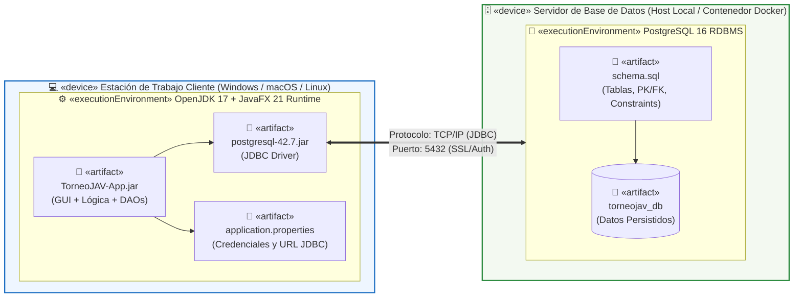

# Diagrama de Despliegue — TorneoJAV

## 1. Descripción de la Infraestructura Física y Lógica
El diagrama de despliegue modela la topología de ejecución cliente-servidor de **TorneoJAV** mediante dos nodos principales interconectados por red local o nube:
1. **Nodo Cliente (`«device» Estación de Trabajo Usuario`):** Computador donde los usuarios (*Administrador*, *Capitán* o *Árbitro*) ejecutan la aplicación de escritorio sobre el entorno `«executionEnvironment» OpenJDK 17 + JavaFX Runtime`. Contiene los artefactos ejecutables y de configuración (`TorneoJAV-App.jar`, `postgresql-jdbc.jar`, `config.properties`).
2. **Nodo Servidor de Datos (`«device» Servidor de Base de Datos`):** Instancia física o contenedor donde opera el motor `«executionEnvironment» PostgreSQL 16 Server`, encargado de ejecutar el esquema relacional y garantizar la persistencia transaccional (`schema.sql`, `seed_data.sql`).
3. **Protocolo de Comunicación:** Enlace directo mediante **TCP/IP — JDBC** a través del puerto estándar **`5432`**.

---

## 2. Representación Gráfica (UML / Mermaid)

---

## 3. Especificación de Nodos, Artefactos y Comunicaciones

| Elemento | Estereotipo UML | Nombre | Descripción Técnica y Puertos |
|---|---|---|---|
| **Estación de Trabajo Cliente** | `«device»` | PC de Escritorio (Admin / Capitán / Árbitro) | Equipo cliente con mínimo 4 GB RAM, procesador Dual-Core y conectividad de red hacia el servidor de base de datos. |
| **Entorno de Ejecución Java** | `«executionEnvironment»` | OpenJDK 17 + JavaFX Runtime | Máquina virtual de Java encargada de renderizar las vistas JavaFX y ejecutar las capas de negocio y acceso a datos. |
| **Paquete de la Aplicación** | `«artifact»` | `TorneoJAV-App.jar` | Empaquetado compilado con las clases de interfaz, controladores, entidades y DAOs del proyecto. |
| **Conector de Base de Datos** | `«artifact»` | `postgresql-42.7.jar` | Librería oficial JDBC que traduce las operaciones DAO en paquetes del protocolo PostgreSQL. |
| **Servidor de Base de Datos** | `«device»` | Servidor PostgreSQL | Host dedicado o contenedor que aloja el sistema gestor de base de datos relacional. |
| **Motor Relacional** | `«executionEnvironment»` | PostgreSQL 16 | Servicio escuchando peticiones entrantes por el puerto TCP **`5432`**. |
| **Esquema SQL** | `«artifact»` | `schema.sql` | Script DDL de creación de tablas (`usuarios`, `torneos`, `equipos`, `jugadores`, `inscripciones`, `partidos`, `actas`, `eventos`, `posiciones`). |
