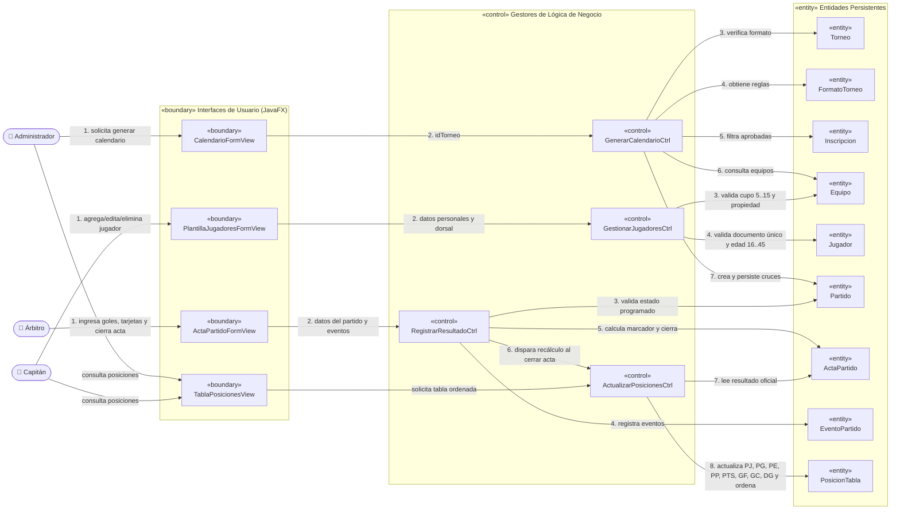

# Diagrama de Análisis (ECB — Entity, Control, Boundary)

## 1. Descripción del Modelo ECB
El patrón **ECB (Entity-Control-Boundary)** estructura el análisis del sistema separando las responsabilidades en tres estereotipos UML:
- **`«boundary»` (Límite):** Interfaces gráficas (vistas y formularios en JavaFX) mediante las cuales los actores (*Administrador*, *Capitán*, *Árbitro*) interactúan con **TorneoJAV**.
- **`«control»` (Control):** Clases gestoras que orquestan la lógica de negocio, validaciones de reglamento y coordinación entre vistas y entidades.
- **`«entity»` (Entidad):** Objetos del dominio persistidos en PostgreSQL que almacenan el estado del torneo.

Se modelan las **Historias de Usuario críticas** del núcleo funcional del sistema:
1. **HU-07:** Generación automática del calendario (8 SP).
2. **HU-08:** Registro de resultados y eventos del partido (8 SP).
3. **HU-09:** Actualización automática de tabla de posiciones (5 SP, encadenada al cierre de acta de HU-08).
4. **HU-05:** Gestión de jugadores de un equipo (8 SP, validación de límites de plantilla y edad).

---

## 2. Representación Gráfica (UML / Mermaid)

---

## 3. Matriz de Elementos ECB por Historia Crítica

| Historia de Usuario | `«boundary»` (Límite) | `«control»` (Control) | `«entity»` (Entidad) | Reglas de Negocio Orquestadas |
|---|---|---|---|---|
| **HU-07: Generación automática del calendario** | `CalendarioFormView` | `GenerarCalendarioCtrl` | `Torneo`, `FormatoTorneo`, `Inscripcion`, `Equipo`, `Partido` | Verifica que el torneo tenga formato definido (*Todos contra todos* o *Eliminación directa*), toma solo equipos con inscripción `APROBADA` y evita partidos duplicados. |
| **HU-08: Registro de resultados y eventos** | `ActaPartidoFormView` | `RegistrarResultadoCtrl` | `Partido`, `ActaPartido`, `EventoPartido` | Registra goles y tarjetas, calcula el marcador final y cambia el estado del acta a `CERRADA`, bloqueando ediciones posteriores. |
| **HU-09: Actualización automática de posiciones** | `TablaPosicionesView` | `ActualizarPosicionesCtrl` | `ActaPartido`, `PosicionTabla`, `Equipo` | Se activa exclusivamente al cerrar un acta en HU-08; actualiza `PJ`, `PG`, `PE`, `PP`, `PTS`, `GF`, `GC`, `DG` y ordena por `PTS → DG → GF`. |
| **HU-05: Gestión de jugadores de un equipo** | `PlantillaJugadoresFormView` | `GestionarJugadoresCtrl` | `Equipo`, `Jugador` | Valida que el Capitán sea dueño del equipo, que la plantilla tenga entre 5 y 15 jugadores, documento no duplicado y edad entre 16 y 45 años. |
