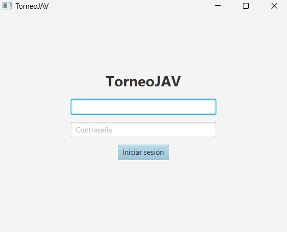
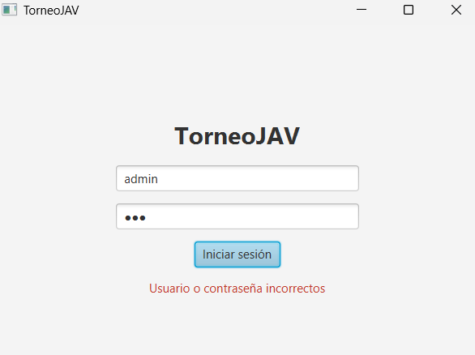
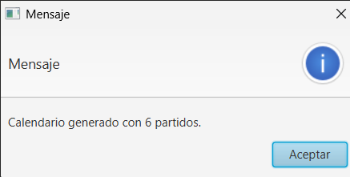
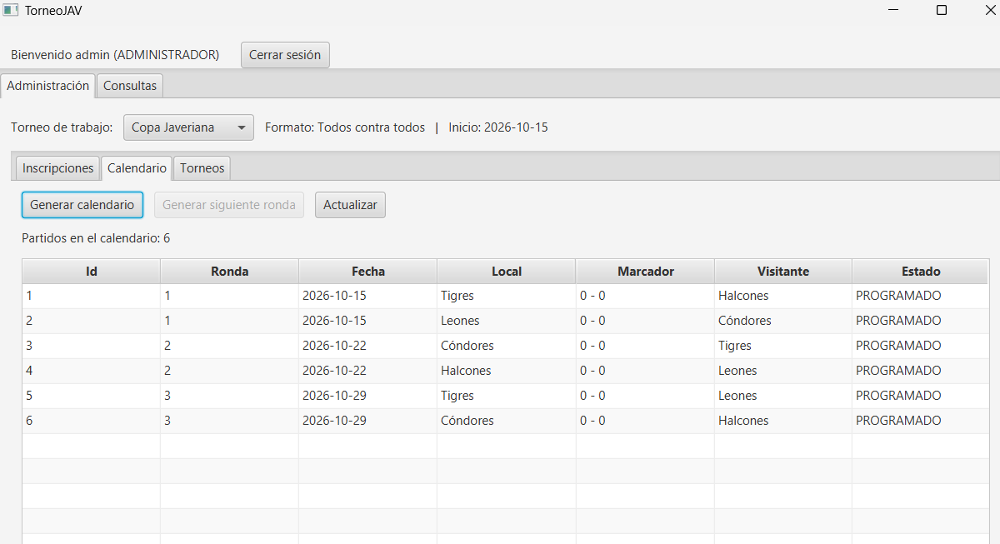
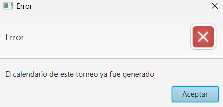
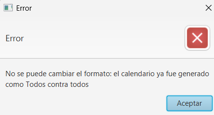
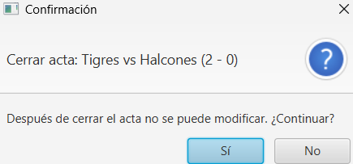
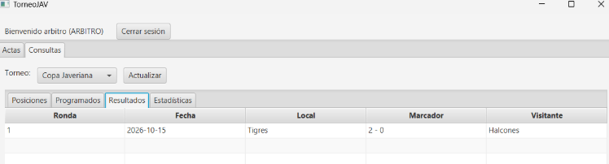
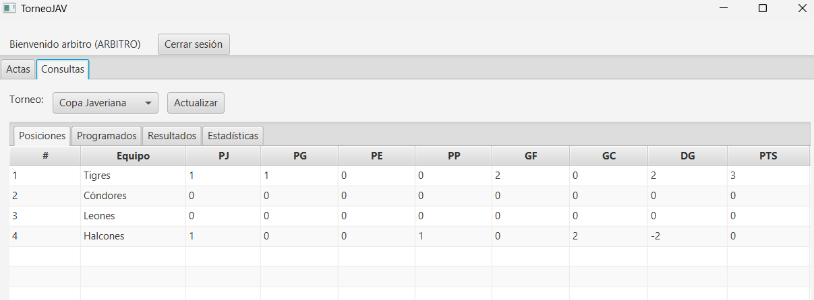
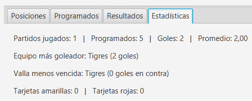

# Informe de prueba de humo — TorneoJAV

## 1. Objetivo
Verificar de forma rápida que las funcionalidades principales de TorneoJAV (autenticación, calendario, formato, jugadores, actas y consultas) funcionan antes de iniciar pruebas más profundas (casos de prueba en Azure Test Plans y pruebas unitarias).

## 2. Datos de la ejecución

| Dato | Valor |
|---|---|
| Fecha | 17/11/2026 |
| Ejecutado por | Natalia Valencia (QA) |
| Versión probada (commit) | 2a4da56 |
| Sistema operativo | Windows 11 (10.0, amd64) |
| Java | Oracle Java 21.0.12.1 LTS |
| Maven | 3.10.1 |
| Base de datos | PostgreSQL 16, reiniciada con `db/schema.sql` antes de la prueba |
| Interfaz probada | Gráfica (JavaFX), ejecutada con `mvn javafx:run` |
| Usuarios usados | `admin`, `capitan` y `arbitro` (datos de ejemplo de `schema.sql`) |

## 3. Estado inicial
Tras reiniciar la base de datos, el torneo "Copa Javeriana" (formato Todos contra todos, inicio 2026-10-15) tiene cuatro equipos aprobados (Tigres, Leones, Cóndores, Halcones) y uno pendiente de aprobación (Pumas).

## 4. Resultados

| # | HU | Acción | Resultado esperado | Resultado obtenido | Estado |
|---|---|---|---|---|---|
| 1 | HU-01 | Iniciar sesión con `admin` y una contraseña errada | El sistema rechaza el acceso con mensaje de credenciales incorrectas | Se mostró el mensaje "Usuario o contraseña incorrectos" y no se permitió el acceso | PASÓ |
| 2 | HU-07 | Como `admin`, generar el calendario del torneo | Se generan 6 partidos en 3 jornadas; Pumas no aparece | Mensaje "Calendario generado con 6 partidos". Se listaron 6 partidos en 3 rondas (15, 22 y 29 de octubre) entre Tigres, Leones, Cóndores y Halcones; Pumas no aparece | PASÓ |
| 3 | HU-07 | Generar el calendario por segunda vez | Error: el calendario ya fue generado | Error "El calendario de este torneo ya fue generado" | PASÓ |
| 4 | HU-03 | Intentar cambiar el formato del torneo con el calendario ya generado | Error: no se puede cambiar el formato porque el calendario ya existe | Error "No se puede cambiar el formato: el calendario ya fue generado como Todos contra todos" | PASÓ |
| 5 | HU-05 | Como `capitan`, agregar un jugador fuera del rango de edad | Error: la edad debe estar entre 16 y 45 años | Se probó con un jugador de 12 años. Error "La edad del jugador (12) debe estar entre 16 y 45 años" | PASÓ |
| 6 | HU-05 | Como `capitan`, ver los jugadores de Leones (equipo 2) | Error: el equipo no pertenece al capitán | La interfaz gráfica no ofrece esta acción, por lo que no se pudo ejecutar | NO EJECUTABLE POR GUI |
| 7 | HU-08, HU-09 | Como `arbitro`, registrar goles en el partido 1 y cerrar el acta | El partido 1 queda 2-0 y la tabla se actualiza | El sistema pidió confirmación ("Cerrar acta: Tigres vs Halcones (2 - 0)"), mostró "Marcador final: 2 - 0. La tabla de posiciones fue actualizada" y el resultado aparece en la pestaña Resultados | PASÓ |
| 8 | HU-08 | Registrar un evento en el partido 1 ya cerrado | Error: el acta está cerrada | El partido cerrado ya no aparece en la lista para registrar actas, por lo que no se pudo intentar la acción desde la interfaz | NO EJECUTABLE POR GUI |
| 9 | HU-09 | Consultar la tabla de posiciones | Tigres primero con 3 puntos | Tigres primero con 1 PJ, 1 PG, GF 2, GC 0, DG +2 y 3 puntos. Halcones con 1 PJ, 1 PP, DG -2 y 0 puntos | PASÓ |
| 10 | HU-10 | Consultar las estadísticas del torneo | 1 partido jugado, 2 goles, Tigres como goleador | Partidos jugados 1, programados 5, goles 2, promedio 2,00. Equipo más goleador: Tigres (2 goles). Tarjetas amarillas y rojas: 0 | PASÓ |

## 5. Evidencias

### Paso 1 — Login con contraseña errada

### Paso 2 — Calendario generado

### Paso 3 — Calendario repetido

### Paso 4 — Cambio de formato con calendario generado

### Paso 5 — Jugador fuera del rango de edad

### Paso 6 — Jugadores de un equipo ajeno
No ejecutable desde la interfaz gráfica. Se cubrirá con una prueba unitaria sobre `JugadorService`.

### Paso 7 — Cierre de acta

### Paso 8 — Evento sobre un acta cerrada
No ejecutable desde la interfaz gráfica, porque el partido ya cerrado deja de aparecer en la lista de actas. Se cubrirá con una prueba unitaria sobre `ResultadoService`.

### Paso 9 — Tabla de posiciones

### Paso 10 — Estadísticas

## 6. Resumen

| Estado | Cantidad |
|---|---|
| PASÓ | 8 |
| FALLÓ | 0 |
| NO EJECUTABLE POR GUI | 2 |

## 7. Defectos encontrados
No se encontraron defectos en esta ejecución.

## 8. Observaciones
- En el paso 5 se usó un jugador de 12 años en lugar de 14. No se probaron los límites exactos del rango (15 y 16 años, 45 y 46 años); eso se cubrirá en los casos de prueba y en las pruebas unitarias.
- Los pasos 6 y 8 validan reglas que la interfaz gráfica no permite intentar. Las reglas existen en la capa de servicios y se verificarán con pruebas unitarias.

## 9. Conclusión
Las funcionalidades principales de TorneoJAV (autenticación, generación de calendario, control de formato, validación de edad de jugadores, cierre de actas, tabla de posiciones y estadísticas) funcionan según lo esperado en la versión `2a4da56`. Se puede continuar con las pruebas detalladas.
