# Reporte de Pruebas — TorneoJAV

## 1. Información General

| Dato | Valor |
|---|---|
| **Proyecto** | TorneoJAV |
| **Responsable de QA** | Natalia Valencia (QA Lead) |
| **Fecha del reporte** | 19/11/2026 |
| **Periodo de ejecución** | 17/11/2026 al 19/11/2026 |
| **Herramienta de gestión de pruebas** | Azure DevOps — Azure Test Plans |
| **Plan de pruebas** | Test Plan 144: Pruebas TorneoJAV (Area/Iteration: ProyectoCali) |
| **Suite ejecutada** | Suite 160: Suite completa (suite estática, 58 casos de prueba) |
| **Configuración** | Windows 10 |
| **Tipo de prueba** | Funcional, manual, sobre la interfaz gráfica (JavaFX) |

---

## 2. Objetivo

Verificar que TorneoJAV cumple los criterios de aceptación de las 10 Historias de Usuario (`HU-01` a `HU-10`), las reglas de negocio asociadas y el control de acceso por rol, y registrar los defectos encontrados para su corrección.

## 3. Alcance

**Dentro del alcance**

- Funcionalidades de las HU-01 a HU-10 ejecutadas desde la interfaz gráfica JavaFX (`mvn javafx:run`).
- Persistencia en PostgreSQL 16 (se reabrió la aplicación y se consultó la base de datos en los casos que lo exigen).
- Roles: Administrador (`admin`), Capitán (`capitan`, `capitan2`) y Árbitro (`arbitro`).
- Casos adicionales de validación (casos de borde y reglas de integridad) diseñados para descubrir defectos.

**Fuera del alcance**

- Pruebas de rendimiento, carga y usabilidad.
- Pruebas automatizadas: al momento del reporte el repositorio **no contiene** una carpeta `src/test` ni pruebas unitarias (ver sección 11, Limitaciones).
- Reglas que la interfaz gráfica no permite intentar (por ejemplo, modificar un equipo ajeno); estas existen en la capa de servicios y quedaron pendientes de prueba unitaria.

## 4. Estrategia y Entorno de Pruebas

| Elemento | Detalle |
|---|---|
| Estrategia | Pruebas funcionales manuales basadas en criterios de aceptación (`CA-xx`) de cada HU, con trazabilidad Caso de prueba ↔ HU ↔ CA |
| Orden de ejecución | 1) Prueba de humo (17/11), 2) Casos de prueba por HU (runs 1000025), 3) Casos adicionales orientados a defectos (run 1000027) |
| Sistema operativo | Windows (configuración de Azure Test Plans: Windows 10) |
| Navegador usado para Azure Test Runner | Google Chrome 157 |
| Aplicación | TorneoJAV v1.0.0 — Java 17+, JavaFX 21.0.5, Maven |
| Base de datos | PostgreSQL 16, reiniciada con `db/schema.sql` |
| Datos de prueba | `admin/admin123`, `capitan/cap123`, `capitan2/cap456`, `arbitro/arb123`; torneo "Copa Javeriana" (4 equipos aprobados y Pumas pendiente) |
| Build en Azure | No asociado (Build number: 0) |

La prueba de humo previa (17/11/2026) está documentada en [`informe-de-prueba-de-humo.md`](informe-de-prueba-de-humo.md).

---

## 5. Resumen de Resultados

| Métrica | Valor |
|---|---|
| Casos de prueba ejecutados | **58 de 58 (100 %)** |
| Casos **Passed** | **47** |
| Casos **Failed** | **11** |
| Casos bloqueados / no ejecutados | 0 |
| Porcentaje de aprobación | **81,0 %** (47/58) |
| Defectos registrados (Bugs en Azure) | **11** (`#247` a `#257`) |

### 5.1 Resultados por Historia de Usuario

| HU | Descripción | Casos | Passed | Failed | Bugs |
|---|---|---|---|---|---|
| HU-01 | Autenticación por roles | 6 | 6 | 0 | — |
| HU-02 | Gestión de torneos | 6 | 5 | 1 | #257 |
| HU-03 | Formato del torneo | 3 | 3 | 0 | — |
| HU-04 | Registro de equipos | 6 | 5 | 1 | #248 |
| HU-05 | Gestión de jugadores | 13 | 9 | 4 | #253, #254, #255, #256 |
| HU-06 | Inscripciones | 6 | 4 | 2 | #247, #249 |
| HU-07 | Generación de calendario | 5 | 4 | 1 | #250 (y #249) |
| HU-08 | Resultados y actas | 6 | 4 | 2 | #251, #252 |
| HU-09 | Tabla de posiciones | 4 | 4 | 0 | — |
| HU-10 | Consultas y estadísticas | 3 | 3 | 0 | — |
| **Total** | | **58** | **47** | **11** | **11** |

> Nota: el caso 224 (clasificado como HU-07) falla por dos defectos, uno de HU-06 (#249) y uno de HU-07 (#250); aquí se cuenta una sola vez en HU-07. El caso 225 (HU-06) también corresponde al defecto #249.

---

## 6. Detalle de Casos de Prueba Ejecutados

Todos los casos fueron asignados y ejecutados por Natalia Valencia en la configuración Windows 10 (Azure Test Plans, suite 160).

### 6.1 Casos aprobados (47)

| ID | Caso de prueba | HU | Resultado |
|---|---|---|---|
| 169 | CP-HU01-Login-con-credenciales-validas | HU-01 | Passed |
| 170 | CP-HU01-Login-con-contraseña-errada | HU-01 | Passed |
| 171 | CP-HU01-Login-con-usuario-inexistente | HU-01 | Passed |
| 172 | CP-HU01-Login-con-campos-vacios | HU-01 | Passed |
| 173 | CP-HU01-Funcionalidades-visibles-segun-rol | HU-01 | Passed |
| 235 | CP-HU01-Contrasenas-no-guardadas-en-texto-plano | HU-01 | Passed (ver discrepancia en sección 8.5) |
| 174 | CP-HU02-Crear-torneo-con-datos-validos | HU-02 | Passed |
| 175 | CP-HU02-Crear-torneo-sin-nombre | HU-02 | Passed |
| 176 | CP-HU02-Modificar-torneo | HU-02 | Passed |
| 177 | CP-HU02-Eliminar-torneo-sin-informacion-con-confirmacion | HU-02 | Passed |
| 178 | CP-HU02-Eliminar-torneo-con-equipos-o-partidos | HU-02 | Passed |
| 179 | CP-HU03-Seleccionar-formato-al-crear-torneo | HU-03 | Passed |
| 180 | CP-HU03-Cambiar-formato-con-calendario-generado | HU-03 | Passed |
| 181 | CP-HU03-Generar-calendario-sin-formato-definido | HU-03 | Passed |
| 182 | CP-HU04-Registrar-equipo-valido | HU-04 | Passed |
| 183 | CP-HU04-Registrar-equipo-sin-nombre | HU-04 | Passed |
| 184 | CP-HU04-Registrar-equipo-duplicado | HU-04 | Passed |
| 185 | CP-HU04-Modificar-nombre-de-equipo-propio | HU-04 | Passed |
| 186 | CP-HU04-Equipos-de-otro-capitan-no-visibles | HU-04 | Passed |
| 187 | CP-HU05-Agregar-jugador-valido | HU-05 | Passed |
| 188 | CP-HU05-Agregar-jugador-fuera-de-rango-de-edad | HU-05 | Passed |
| 189 | CP-HU05-Limites-de-edad-16-y-45 | HU-05 | Passed |
| 190 | CP-HU05-Agregar-jugador-con-documento-repetido | HU-05 | Passed |
| 191 | CP-HU05-Agregar-jugador-sin-datos-obligatorios | HU-05 | Passed |
| 192 | CP-HU05-Limite-maximo-de-15-jugadores | HU-05 | Passed |
| 193 | CP-HU05-Editar-jugador-propio | HU-05 | Passed |
| 194 | CP-HU05-Eliminar-jugador-y-minimo-de-5 | HU-05 | Passed |
| 195 | CP-HU05-Jugadores-de-otro-equipo-no-modificables | HU-05 | Passed |
| 196 | CP-HU06-Ver-pendientes-y-aprobar-inscripcion | HU-06 | Passed |
| 197 | CP-HU06-Rechazar-inscripcion | HU-06 | Passed |
| 198 | CP-HU06-Capitan-consulta-estado-de-inscripcion | HU-06 | Passed |
| 199 | CP-HU06-Calendario-incluye-aprobados-y-excluye-rechazados | HU-06 | Passed |
| 200 | CP-HU07-Generar-calendario-todos-contra-todos | HU-07 | Passed |
| 201 | CP-HU07-Generar-calendario-repetido | HU-07 | Passed |
| 202 | CP-HU07-Generar-calendario-con-menos-de-2-equipos-aprobados | HU-07 | Passed |
| 203 | CP-HU07-Eliminacion-directa-por-rondas | HU-07 | Passed |
| 204 | CP-HU08-Registrar-goles-y-tarjetas-de-un-partido | HU-08 | Passed |
| 205 | CP-HU08-Cerrar-acta-del-partido | HU-08 | Passed |
| 206 | CP-HU08-Registrar-evento-con-acta-cerrada | HU-08 | Passed |
| 207 | CP-HU08-Cerrar-acta-empatada-en-eliminacion-directa | HU-08 | Passed |
| 208 | CP-HU09-Tabla-sin-cambios-antes-de-cerrar-acta | HU-09 | Passed |
| 209 | CP-HU09-Tabla-actualizada-al-cerrar-acta | HU-09 | Passed |
| 210 | CP-HU09-Orden-de-tabla-por-puntos-DG-y-GF | HU-09 | Passed |
| 226 | CP-HU09-Tabla-incluye-equipo-aprobado-despues-de-un-acta | HU-09 | Passed |
| 211 | CP-HU10-Consultar-programados-finalizados-y-posiciones | HU-10 | Passed |
| 212 | CP-HU10-Consultar-estadisticas-generales | HU-10 | Passed |
| 213 | CP-HU10-Consultas-no-modifican-datos-y-exigen-sesion | HU-10 | Passed |

### 6.2 Casos fallidos (11)

| ID | Caso de prueba | HU | Resultado esperado (resumen) | Defecto |
|---|---|---|---|---|
| 223 | CP-HU06-Aprobar-equipo-sin-jugadores | HU-06 | El sistema rechaza aprobar un equipo con menos de 5 jugadores | #247 |
| 224 | CP-HU07-Eliminacion-directa-equipo-aprobado-despues-del-calendario | HU-07 | No se aprueban inscripciones tras generar el calendario; el ganador de la ronda 1 pasa a la ronda 2 | #249, #250 |
| 225 | CP-HU06-Aprobar-inscripcion-despues-de-generar-calendario | HU-06 | Ningún equipo aprobado queda fuera del calendario | #249 (relacionado) |
| 227 | CP-HU08-Corregir-evento-registrado-por-error | HU-08 | Existe forma de corregir/eliminar un evento antes de cerrar el acta | #251 |
| 228 | CP-HU08-Jugador-expulsado-no-puede-seguir-en-el-partido | HU-08 | Un jugador con tarjeta roja no puede registrar más eventos | #252 |
| 229 | CP-HU05-Fecha-de-nacimiento-futura | HU-05 | Mensaje claro; no se muestra una edad negativa | #254 |
| 230 | CP-HU05-Camiseta-repetida-en-el-equipo | HU-05 | No se permiten dos jugadores con la misma camiseta en un equipo | #255 |
| 231 | CP-HU05-Documento-repetido-en-otro-equipo | HU-05 | Una persona no puede estar inscrita en dos equipos del mismo torneo | #256 |
| 232 | CP-HU05-Errores-tecnicos-de-base-de-datos-en-mensajes | HU-05 | Mensaje claro, sin texto técnico de PostgreSQL | #253 |
| 233 | CP-HU04-Nombre-de-equipo-casi-duplicado | HU-04 | Se rechaza un nombre casi idéntico (espacios dobles) | #248 |
| 234 | CP-HU02-Crear-torneo-con-nombre-repetido | HU-02 | No existen dos torneos con el mismo nombre | #257 |

---

## 7. Defectos Encontrados

La severidad es una propuesta del equipo de QA y puede ajustarse en la retrospectiva. El estado actual de cada Bug debe verificarse en Azure Boards.

| Bug | HU | Título | Caso(s) | Severidad propuesta |
|---|---|---|---|---|
| #247 | HU-06 | Se aprueba un equipo sin jugadores | 223 | Alta |
| #248 | HU-04 | Se aceptan nombres de equipo casi idénticos (sin tilde o con espacios dobles) | 233 | Media |
| #249 | HU-06 | Se puede aprobar una inscripción después de generar el calendario; el equipo queda aprobado sin partidos | 224, 225 | Alta |
| #250 | HU-07 | En eliminación directa, un equipo aprobado después del calendario entra a la ronda 2 y el ganador de la ronda 1 queda fuera | 224 | Crítica |
| #251 | HU-08 | No hay forma de corregir o eliminar un evento registrado por error antes de cerrar el acta | 227 | Alta |
| #252 | HU-08 | Un jugador expulsado puede seguir marcando goles y registrando eventos | 228 | Media |
| #253 | HU-05 | Errores técnicos de PostgreSQL visibles al usuario (documento largo, eliminar jugador con eventos) | 232 | Media |
| #254 | HU-05 | Con fecha de nacimiento futura el mensaje muestra una edad negativa | 229 | Baja |
| #255 | HU-05 | Se permiten dos jugadores con la misma camiseta en un equipo | 230 | Media |
| #256 | HU-05 | El mismo documento puede inscribirse en dos equipos del mismo torneo | 231 | Alta |
| #257 | HU-02 | Se pueden crear dos torneos con el mismo nombre | 234 | Media |

### Distribución por severidad propuesta

| Severidad | Cantidad |
|---|---|
| Crítica | 1 |
| Alta | 4 |
| Media | 5 |
| Baja | 1 |

### Análisis

- **HU-05 (jugadores) concentra 4 de los 11 defectos**: faltan validaciones de integridad (camiseta, documento entre equipos, fecha futura) y mensajes de error amigables.
- **El flujo inscripción → calendario → rondas (HU-06/HU-07) tiene el defecto más grave (#250)**: aprobar un equipo después de generado el calendario deja el torneo en un estado inconsistente.
- **Las reglas de unicidad** (nombres de torneo y de equipo, camiseta, documento) están validadas de forma incompleta en la capa de servicios.
- **El flujo de actas (HU-08)** no permite corregir errores de digitación ni respeta la expulsión de un jugador.

---

## 8. Evidencias

Las capturas de pantalla y la información del sistema fueron exportadas desde Azure Test Plans y se encuentran en `docs/qa/evidencias/`. La guía completa de la carpeta está en [`evidencias/README.md`](evidencias/README.md). En esta sección se muestran las capturas más representativas; el resto está en las carpetas indicadas.

### 8.1 Organización de las evidencias

| Carpeta | Contenido | Casos cubiertos |
|---|---|---|
| `evidencias_prueba_de_humo/` | 12 capturas `PH-XX` de la prueba de humo (17/11/2026) | Pasos 0 a 10 de la prueba de humo |
| `evidencias_run_1000025/` | 66 capturas de pantalla por paso | Casos 170–213 |
| `evidencias_run_1000027/` | 32 capturas y 15 archivos `SystemInformation` (`.json`) | Casos 223–235 (casos adicionales orientados a defectos) |

Convención de nombre en los runs de Azure: `<ID caso>_<nombre del caso>_Paso_Screenshot_<fecha-hora>.png`. Las capturas de la prueba de humo siguen la convención `PH-XX-descripcion.png`.

### 8.2 Evidencias de la prueba de humo (17/11/2026)

La prueba de humo cerró con 8 pasos aprobados, 0 fallidos y 2 no ejecutables por la interfaz gráfica. Detalle completo en [`informe-de-prueba-de-humo.md`](informe-de-prueba-de-humo.md).

**Calendario generado (6 partidos en 3 rondas, sin Pumas)**

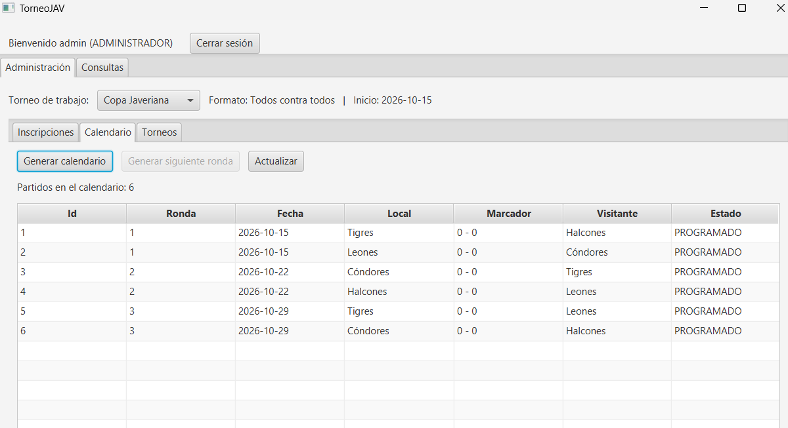

**Cierre de acta: marcador final 2 - 0 y tabla actualizada**

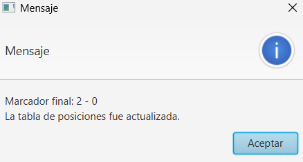

**Tabla de posiciones: Tigres primero con 3 puntos**

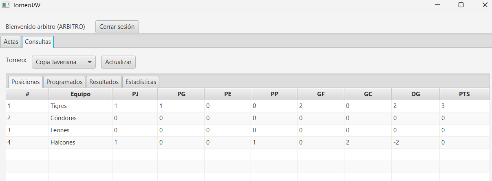

### 8.3 Evidencias de un caso aprobado

**Caso 209 — CP-HU09-Tabla-actualizada-al-cerrar-acta (Passed).** Tras cerrar el acta, Tigres lidera con 3 puntos y DG +2, y Halcones queda con 0 puntos y DG -2.

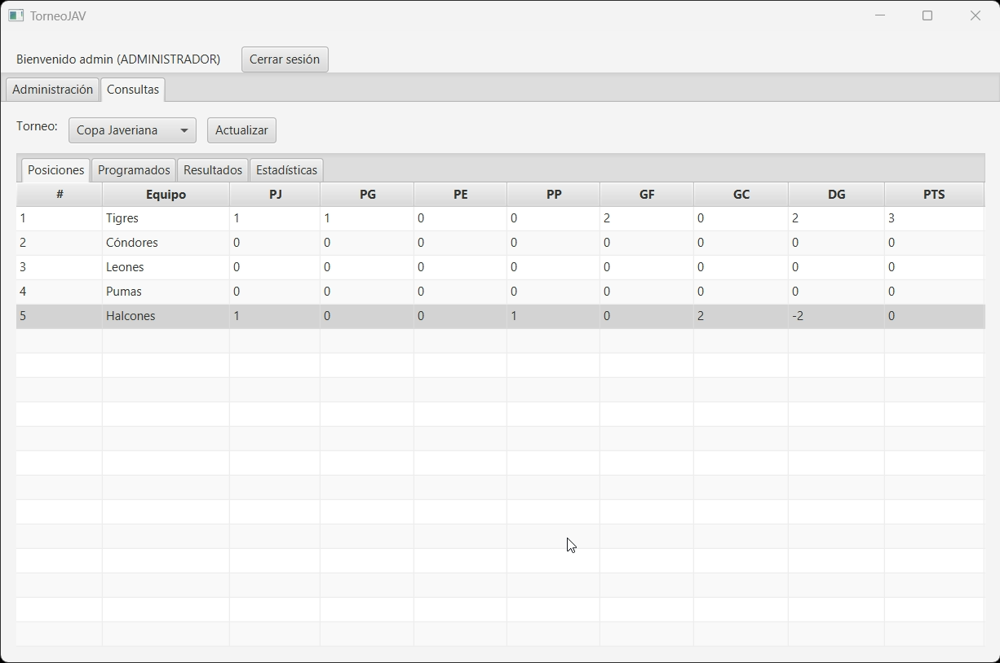

### 8.4 Evidencias de los defectos encontrados

Se muestran las capturas de los defectos con mayor impacto o más fáciles de reconocer en pantalla. Las capturas de los casos 225, 230 y 231 (defectos #249, #255 y #256) están en `evidencias_run_1000027/`.

**#250 (Crítica) — Caso 224: el ganador de la ronda 1 queda fuera de la ronda 2.** En "Torneo Bug KO" (eliminación directa), T-B ganó la ronda 1 (1 - 0), pero la ronda 2 se programó entre T-A, un equipo aprobado después del calendario, y T-D.

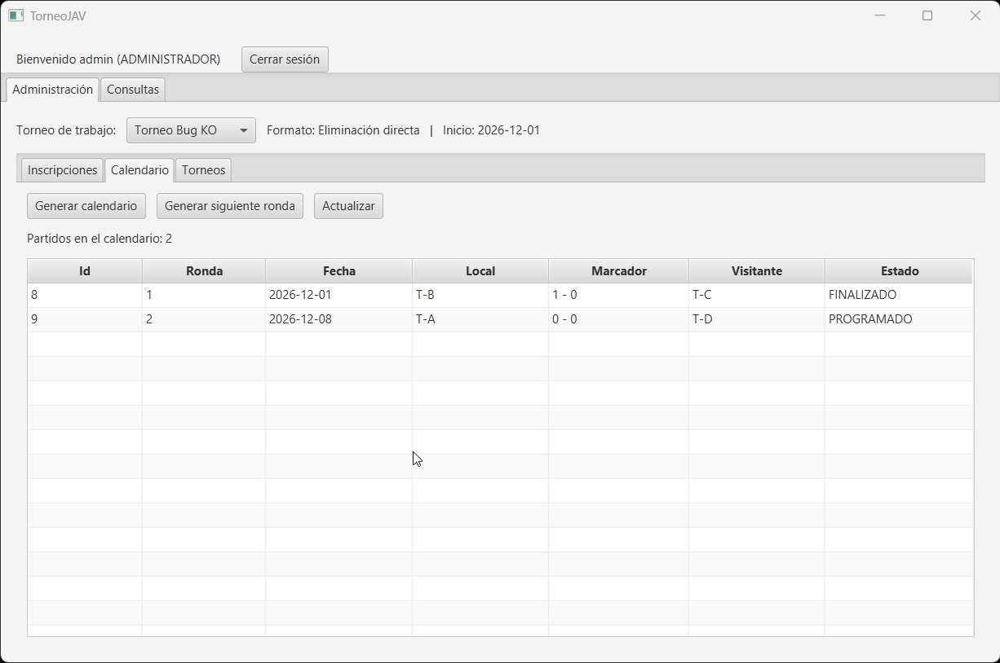

**#247 (Alta) — Caso 223: se aprueba un equipo sin jugadores.** El equipo de prueba "Sin Jugadores FC" (Torneo QA) aparece con estado APROBADO.

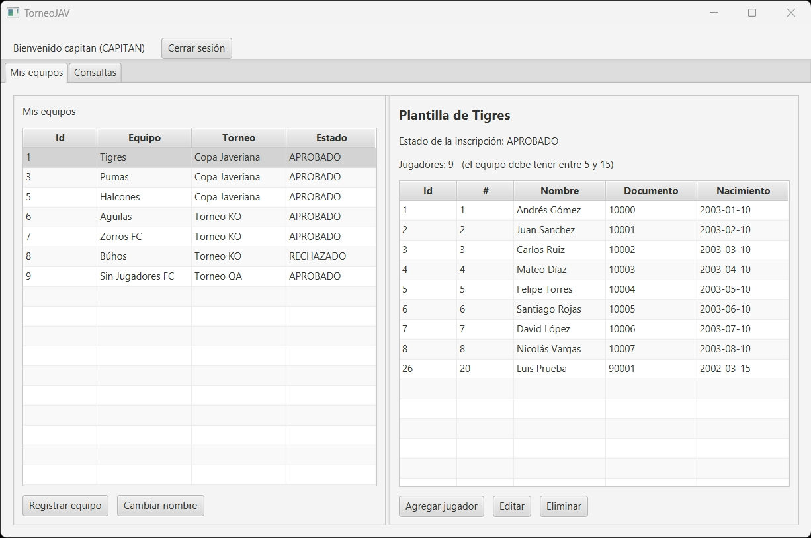

**#251 (Alta) — Caso 227: no hay forma de corregir un evento.** En el acta Leones vs Cóndores (1 - 0) el gol del minuto 20 quedó registrado; la pantalla solo ofrece "Registrar evento" y "Cerrar acta", sin opción de editar o eliminar eventos.

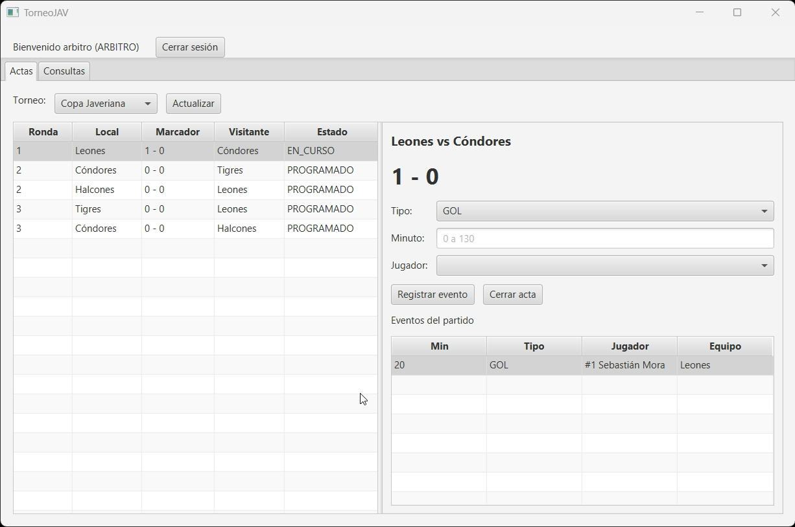

**#252 (Media) — Caso 228: un jugador expulsado sigue marcando.** Daniel Castro (Leones) recibe tarjeta roja en el minuto 10 y aun así se le registra un gol en el minuto 80 (marcador 2 - 0).

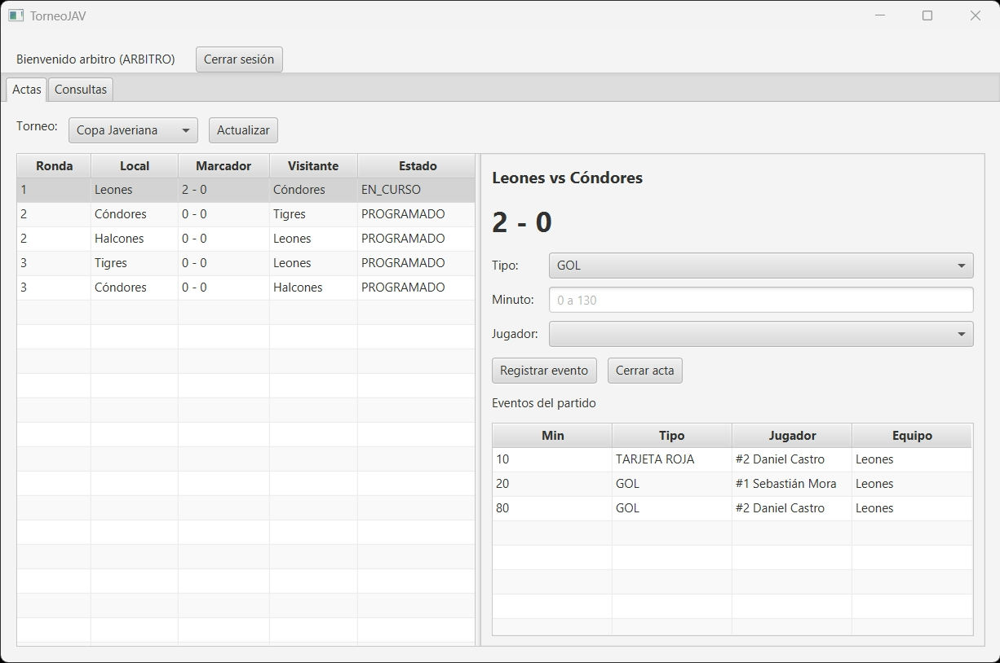

**#257 (Media) — Caso 234: dos torneos con el mismo nombre.** El listado de torneos muestra dos "Copa Javeriana" (ids 1 y 6).

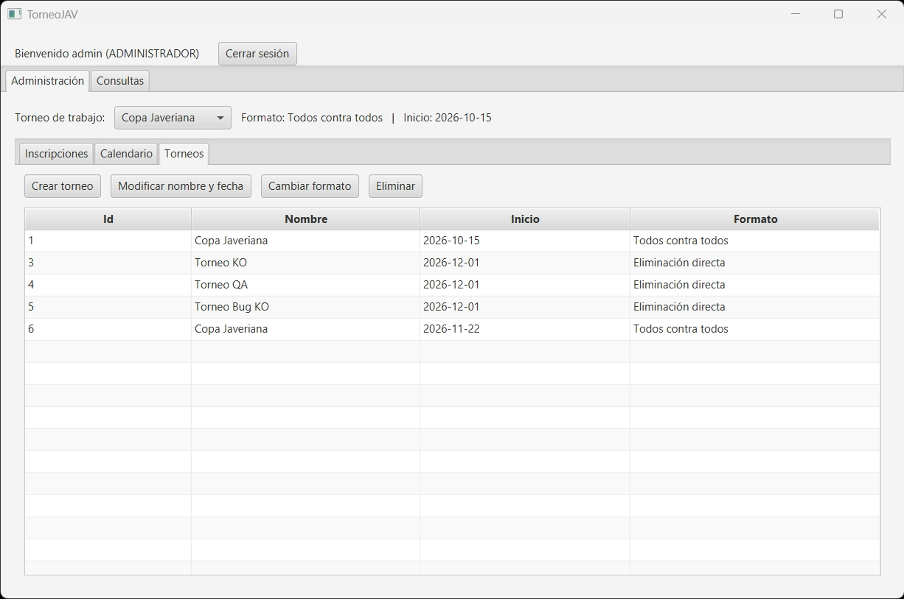

**#248 (Media) — Caso 233: nombre de equipo casi duplicado.** Junto a "Zorros FC" quedó registrado "Zorros  FC" (con doble espacio) con estado PENDIENTE.

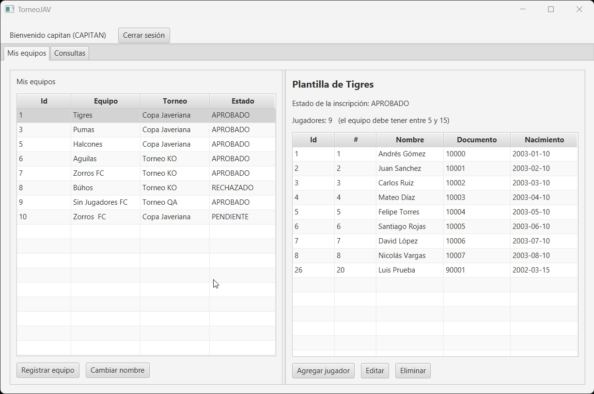

**#253 (Media) — Caso 232: error técnico de PostgreSQL visible al usuario.** Al eliminar un jugador con eventos registrados, el mensaje muestra texto de la base de datos (llave foránea `evento_partido_jugador_id_fkey`).

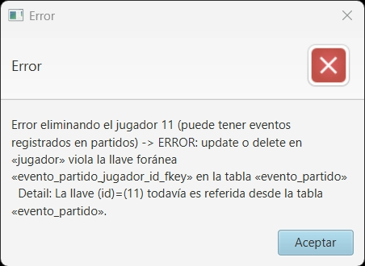

**#254 (Baja) — Caso 229: edad negativa en el mensaje.** Con una fecha de nacimiento futura, el mensaje indica "La edad del jugador (-5) debe estar entre 16 y 45 años".

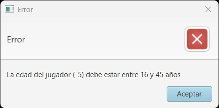

### 8.5 Discrepancias detectadas durante la elaboración del reporte

| # | Hallazgo | Acción recomendada |
|---|---|---|
| 1 | El caso **235** (contraseñas no guardadas en texto plano) quedó en **Passed**, pero `db/schema.sql` inserta las contraseñas en texto plano (`'admin123'`, `'cap123'`, etc.) y `AutenticacionService` las compara con `equals`. Esto coincide con la deuda técnica **DT-01** del `registro-de-deuda.md`. | Revisar el caso: o se reclasifica como **Failed** y se abre un Bug, o se corrige el código (hash de contraseñas) y se vuelve a ejecutar. |
| 2 | Los casos **186, 195 y 206** indican que ciertas reglas se validan "con prueba unitaria", pero el repositorio no tiene `src/test`. | Crear las pruebas unitarias (`JugadorService`, `EquipoService`, `ResultadoService`) o documentar la regla como cubierta solo por revisión de código. |

---

## 9. Matriz de Trazabilidad

Relación entre cada Historia de Usuario, sus casos de prueba y los defectos asociados.

| HU | Casos aprobados | Casos fallidos | Bugs | Estado |
|---|---|---|---|---|
| HU-01 | 169, 170, 171, 172, 173, 235 | — | — | Cumple (sujeto a la discrepancia del caso 235) |
| HU-02 | 174, 175, 176, 177, 178 | 234 | #257 | Abierta |
| HU-03 | 179, 180, 181 | — | — | Cumple |
| HU-04 | 182, 183, 184, 185, 186 | 233 | #248 | Abierta |
| HU-05 | 187, 188, 189, 190, 191, 192, 193, 194, 195 | 229, 230, 231, 232 | #253, #254, #255, #256 | Abierta |
| HU-06 | 196, 197, 198, 199 | 223, 225 | #247, #249 | Abierta |
| HU-07 | 200, 201, 202, 203 | 224 | #250 (y #249) | Abierta |
| HU-08 | 204, 205, 206, 207 | 227, 228 | #251, #252 | Abierta |
| HU-09 | 208, 209, 210, 226 | — | — | Cumple |
| HU-10 | 211, 212, 213 | — | — | Cumple |

---

## 10. Riesgos y Plan de Regresión

### 10.1 Riesgos identificados

| Riesgo | Origen | Impacto |
|---|---|---|
| Torneos en estado inconsistente (equipos aprobados sin partidos, ganadores que no avanzan) | Defectos #249 y #250 | Un torneo en eliminación directa puede quedar mal armado y no se corrige desde la interfaz |
| Datos duplicados o inválidos (torneos, equipos, camisetas, documentos) | Defectos #248, #255, #256 y #257 | Información poco confiable en tablas, calendarios y estadísticas |
| Errores en actas sin posibilidad de corrección | Defectos #251 y #252 | Resultados y tabla de posiciones incorrectos una vez cerrada el acta |
| Contraseñas almacenadas en texto plano | Discrepancia 1 (DT-01) | Riesgo de seguridad; el caso 235 quedó en Passed pese a esto |
| Reglas de servicios sin verificar | Ausencia de `src/test` (casos 186, 195 y 206) | Regresiones que no se detectarían de forma automática |

### 10.2 Plan de regresión

Casos que se deben re-ejecutar tras corregir cada defecto, en el orden de prioridad sugerido:

| Orden | Bug | Caso(s) a re-ejecutar | Casos relacionados a revisar |
|---|---|---|---|
| 1 | #250 | 224 | 203 |
| 2 | #249 | 224, 225 | 196, 199, 200 |
| 3 | #247 | 223 | 196 |
| 4 | #256 | 231 | 190 |
| 5 | #251 | 227 | 204, 205 |
| 6 | #252 | 228 | 204 |
| 7 | #255 | 230 | 187, 193 |
| 8 | #257 | 234 | 174, 176 |
| 9 | #248 | 233 | 182, 184 |
| 10 | #253 | 232 | 194 |
| 11 | #254 | 229 | 188, 189 |

---

## 11. Limitaciones

- Las pruebas fueron **manuales**; no existe suite automatizada ni ejecución de `mvn test` (ver `DT-02` en el registro de deuda técnica).
- Todas las ejecuciones fueron realizadas por una sola persona (QA Lead) en un solo entorno (Windows 10).
- Algunas reglas de servicios no son alcanzables desde la interfaz gráfica y no pudieron verificarse (casos 186, 195 y 206, pasos de nota).
- La suite no incluye pruebas de rendimiento ni de seguridad más allá de las reglas funcionales de acceso por rol.

---

## 12. Conclusiones y Recomendaciones

1. Se ejecutaron los **58 casos de prueba (100 %)**: **47 aprobados (81,0 %)** y **11 fallidos**, todos con Bug asociado en Azure DevOps.
2. Las funcionalidades de **autenticación, formato del torneo, tabla de posiciones y consultas (HU-01, HU-03, HU-09, HU-10)** no presentaron fallos funcionales en los casos ejecutados.
3. Los defectos se concentran en **validaciones de integridad y flujos de borde** de HU-02, HU-04, HU-05, HU-06, HU-07 y HU-08. Ninguno impide el flujo principal feliz (crear torneo → inscribir → calendario → actas → posiciones), pero **#250, #249 y #247** afectan la consistencia del torneo y deberían corregirse primero.
4. **Prioridad de corrección sugerida:** #250 → #249 → #247 → #256 → #251 → #252 → #255 → #257 → #248 → #253 → #254.
5. Tras corregir cada defecto se debe **re-ejecutar el caso asociado** (regresión) y cerrar el Bug en Azure DevOps (ver plan de regresión en la sección 10.2).
6. Resolver las discrepancias de la sección 8.5 (caso 235 y pruebas unitarias) antes de declarar la suite como cerrada.

### Criterio de salida (Definition of Done)

Según `definicion-de-terminado.md`, una historia solo se cierra cuando todos sus casos están en **Passed**. Con los resultados actuales, **HU-01, HU-03, HU-09 y HU-10 cumplen ese criterio** (sujeto a la discrepancia del caso 235 para HU-01); **HU-02, HU-04, HU-05, HU-06, HU-07 y HU-08 permanecen abiertas** hasta corregir los defectos y repetir sus casos.
